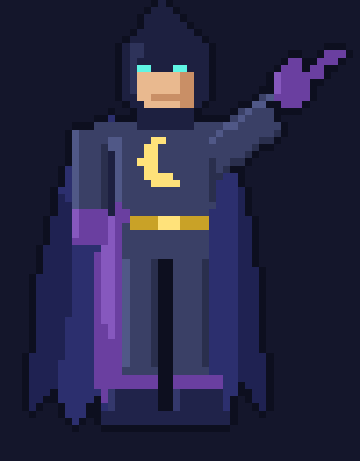

# Break Buddy

**A lazy-person's break reminder that runs entirely on your own laptop.** You tell it what you need in one plain-English sentence, a local open-weight model (Gemma 4 through Ollama) sets everything up, and a pixel-art hero pops up at the right moments to tell you to drink water, rest your eyes, or stretch. It writes a fresh message every time, in whatever personality you picked, and it knows when *not* to bother you, like during a video call.

Built for the **Hacktoberfest 2026 Open-Source AI Challenge, Week 3: "Slow and Steady"**

<!-- Add a screenshot of the popup here:   -->



> The hero is an original character, drawn entirely by Python code (`make_sprite.py`). There are no image files to download.

---

## What it does

- **Set it up by typing a sentence.** For example: *"remind me to drink water every 45 min, rest my eyes every 20, stretch every hour, nothing before 9am or after 8pm, sarcastic friend tone."* The model turns that into a config file.
- **Fresh messages every time**, written in the personality you asked for (sarcastic friend, calm coach, pirate...).
- **Knows what you are doing.** It reads your active window title, and the model labels it as coding, video, meeting, documents, browsing, social or other.
- **Never interrupts a meeting.** Zoom, Google Meet, Teams and Webex windows hold reminders back, and you get one combined popup when you leave the call.
- **Long-break nudges.** After 2 hours of continuous computer time, it tells you to take a proper break. A 5-minute idle gap resets the counter.
- **One popup, not three.** Reminders that come due together share a single popup.
- **Snooze** (10 minutes) and **Done** buttons on every popup.
- **System tray icon** to pause, resume or quit.
- **Retro popup UI.** A pixel hero points at an RPG-style message box, and the message types out letter by letter.
- **Starts with Windows** and runs without a console window.

## Why open-weight, and why local?

A plain "drink water every 45 minutes" timer needs no AI at all. The model is here because it makes real decisions, and because this is a tool that runs all day, which is exactly where a local model beats a cloud one:

- **Privacy.** Window titles reveal your job hunting, banking, health searches and company tools. They are only ever sent to the model on your own machine.
- **Zero running cost.** It makes a few model calls an hour, forever, for free. An API would meter every one of them.
- **Works offline.** Nothing in the app needs the internet once the model is downloaded.
- **You control the model.** Swap `gemma4:e4b` for a bigger one with one line, and the behaviour changes the way you choose, not when a provider updates a model.

Honest trade-off: a large cloud model would probably label unusual window titles a little better. For this job the small local model is enough, and the app has safety rules for the one case where a mistake really matters (meetings).

## Requirements

- **Windows 10 or 11.** It uses the Windows idle-time API, `winsound` and `pythonw`.
- **Python 3.10 or newer.**
- **[Ollama](https://ollama.com)**, a recent version (Gemma 4 needs 0.20.0 or newer), installed and running. Look for the llama icon in your system tray.
- **The Gemma model**, about 10 GB on disk: `ollama pull gemma4:e4b`

## Quick start

```bash
git clone https://github.com/kumudasrip/Break-Buddy.git
cd Break-Buddy

python -m venv venv
venv\Scripts\activate
pip install -r requirements.txt

ollama pull gemma4:e4b

python setup.py          # type what you want, in plain English
python breakbuddy.py     # start the app
```

1. **`python setup.py`** asks what reminders you want. It prints what it understood, and you answer `y` to save `config.json`. The first run is slow while the model loads.
2. **`python breakbuddy.py`** starts the app. A blue icon appears near the clock (check the **^** arrow if you don't see it).
3. To try it quickly, set `TEST_MODE = True` near the top of `breakbuddy.py`. Minutes become seconds, and the long-break nudge comes after 2 minutes. Set it back to `False` for real use.

Without a `config.json`, the app uses sensible defaults (water, eyes, stretch).

### Example setup sentences

```
water every 45 minutes, eyes every 20, stretch every hour, 9am to 8pm, calm tone
remind me to stand up every 30 min, pirate voice
drink water every hour and a half, angry gym bro
```

If the model misreads something, answer `n`, rephrase, and try again. You can also edit `config.json` by hand.

### `config.json`

```json
{
  "personality": "sarcastic friend",
  "active_from": "09:00",
  "active_to": "20:00",
  "reminders": [
    { "name": "Water",   "every_min": 45, "task": "drink a glass of water" },
    { "name": "Eyes",    "every_min": 20, "task": "rest my eyes" },
    { "name": "Stretch", "every_min": 60, "task": "stretch" }
  ]
}
```

## Run it automatically with Windows

1. Quit any running copy (tray icon, then **Quit BreakBuddy**) and make sure `TEST_MODE = False`.
2. Press **Win+R**, type `shell:startup`, and press Enter.
3. Right-click inside the folder, choose **New, then Shortcut**, and paste this as the location (one line, adjust the folder to where you cloned the project):
   ```
   C:\path\to\Break-Buddy\venv\Scripts\pythonw.exe C:\path\to\Break-Buddy\breakbuddy.py
   ```
4. Name it `BreakBuddy`. Then right-click it, choose **Properties**, and set **Start in** to your project folder. This matters: without it the app cannot find `config.json` and silently uses the defaults.
5. Double-click the shortcut to test. There is no console window, only the tray icon.

`pythonw` hides errors. If the tray icon does not appear, run `python breakbuddy.py` in a terminal to see what went wrong.

## How it works

```
 setup.py                      breakbuddy.py
 "water every 45 min,    ┌───────────────────────────────────────────────┐
  sarcastic tone"        │  schedulers  ──► waiting list ──► dispatcher  │
      │                  │  (one per        (each reminder    (holds during
      ▼                  │   reminder)       listed once)      meetings, batches
 local model ──► config  │                                     coinciding ones)
 (structured JSON)       │                                         │
                         │  watcher (every 15 s)                   ▼
                         │  window title ─► meeting patterns ─► model writes ONE message
                         │  ─► local model label   │             in your personality
                         │  idle time ─► screen-time counter          │
                         └────────────────────────────────────────────┼──────┘
                                                                      ▼
                                                  pixel hero popup  (Snooze / Done)
```

- **Natural-language setup (`setup.py`).** The typed sentence goes to the model with a JSON schema (Ollama structured output, temperature 0, thinking off). The result is validated with Pydantic, retried up to 3 times, and shown to you before saving. The schema fields are deliberately *required*, with no defaults, because the small model otherwise copied a default `"friendly"` personality instead of the tone you typed.
- **Window awareness.** Every 15 seconds the app reads the active window title. Fixed patterns for meeting windows run first, as a safety rule (interrupting a call is worse than missing a reminder), then the model labels anything else. Labels are cached per title, so each new title costs one model call. If Ollama is off, simple keyword rules take over.
- **Privacy by design.** The reminder-writing model only sees the label ("coding") and the number of minutes, never the window title itself.
- **Idle detection.** The Windows `GetLastInputInfo` call measures time since your last keyboard or mouse input. Five minutes idle counts as a break.
- **Popups.** A borderless tkinter window with a see-through background (`-transparentcolor`), the sprite scaled with nearest-neighbour zoom, a stair-cornered message box, and a typewriter effect. If the hero popup ever fails, the app falls back to a plain popup so reminders still work.

## Files

| File | What it does |
|---|---|
| `breakbuddy.py` | The app: schedulers, window watcher, dispatcher, tray icon |
| `setup.py` | Turns your typed sentence into `config.json` using the local model |
| `popup_ui.py` | The pixel-hero popup with the retro message box |
| `make_sprite.py` | Draws the hero sprite with Python. Run it to regenerate `hero.png` |
| `requirements.txt` | Python packages |

`config.json` is created by `setup.py` and is personal, so it is not committed. `hero.png` is drawn automatically the first time a popup needs it.

## Customising

| What | Where |
|---|---|
| Which model to use | `MODEL` at the top of `breakbuddy.py` **and** `setup.py` |
| Real minutes vs fast test mode | `TEST_MODE` in `breakbuddy.py` |
| Pixel hero or plain popup | `USE_HERO` in `breakbuddy.py` |
| Snooze length, long-break time, idle reset | the constants under `TEST_MODE` in `breakbuddy.py` |
| Hero colours | the `C` dictionary in `make_sprite.py`, then run `python make_sprite.py` |
| Message box colours, typing speed, popup size | the top of `popup_ui.py` (the `/ 300` in the size line: bigger number, smaller popup) |
| What counts as a meeting | `MEETING_RE` in `breakbuddy.py` |

If you replace the sprite with your own, update `TIP` in `make_sprite.py` and `HERO_TIP` in `popup_ui.py` to the fingertip position so the message box lines up.

## Choosing a model

`gemma4:e4b` is the default because this app lives in the background all day, so a small model is the right size. Bigger models (for example `gemma4:26b`) follow instructions more reliably and are slower and heavier. To try one, change `MODEL` in both `breakbuddy.py` and `setup.py`.

## Troubleshooting

| Problem | Fix |
|---|---|
| Popup has a solid magenta background | The see-through colour is not working on your system. Set `USE_HERO = False` in `breakbuddy.py` |
| Messages are generic ("Time to stretch!") | Ollama is not running or the model is not pulled. Start Ollama and run `ollama pull gemma4:e4b` |
| No tray icon | `pip install pystray pillow`, and check the **^** arrow near the clock |
| `think` argument error | `pip install -U ollama` |
| `setup.py` misreads a sentence | Answer `n` and rephrase, try a larger model, or edit `config.json` by hand |
| App ignores my settings after a restart | Set **Start in** on the startup shortcut to the project folder |
| First popup after a restart is slow | The model is loading into memory. This is normal |

## Known limitations

- **Windows only.**
- **Meeting detection depends on window titles.** Patterns cover the Zoom app, Google Meet tabs, Teams and Webex, and the model catches many other cases. Zoom's home screen ("Zoom Workplace") also holds reminders back, and a call's short "Connecting..." screen can let one slip through.
- **The model can mislabel an unusual window title.** For example, similar pages may get different labels.
- **Idle time counts as a break**, so watching a long video without touching the keyboard resets the screen-time counter.
- **Reminders still pop up if you are away** from the desk. The popup closes itself after 25 seconds.

## Write-up

DEV post: 

## Credits

- [Ollama](https://ollama.com) for running models locally
- [Gemma](https://ai.google.dev/gemma), Google's open-weight model family
- Built for the [Hacktoberfest 2026 Open-Source AI Challenge](https://dev.to) on DEV

## License

MIT. See `LICENSE`.